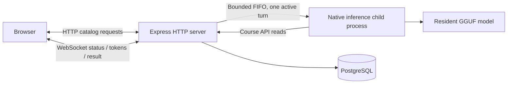

# Server-hosted academic advisor

## Run locally

```bash
npm ci
npm run model:download
npm run dev
```

Open the printed URL and choose **AI advisor**. The server loads the pinned
SmolLM2 360M Q4_K_M GGUF (~271 MB) from `.local/models/smol.gguf` in the background
and keeps it resident. Clients never download weights or a WASM inference runtime.
Native CPU inference uses `node-llama-cpp`; no paid LLM API or GPU is required.
The default is one CPU thread on a two-core host, leaving a core for the web/API.
Allow at least 1 GB RAM for the application and model, plus the database.

The download command caches the model, verifies its size, and installs it by an
atomic rename. It does not overwrite an existing model. Models are not downloaded
on user requests. With no model installed, manual planning and catalog/health
requests remain available; AI mode explains that the server is not configured.

Try this conversation against the explicitly synthetic development catalog:

1. “I'm a 4th-year CS student. I want Fridays off, I like geology electives, and
   I hate Professor X.”
2. “I am eligible for COMP 1405, MATH 1007 and ERTH 1006. Take these three courses.”
3. “Make my Tuesdays lighter, but keep my geology elective.”

These course choices demonstrate the planner, not a recommended fourth-year
curriculum. Requirements stay enforced across turns; preferences rank valid
options. “Keep” pins a course while allowing its section to change. “Never
Professor X” makes a dislike mandatory. The calendar reuses the manual planner's
visualization, and switching modes retains separate plans.

## Concurrency and streaming



There is one inference process and one resident model per web-server instance.
One complete advisor turn runs at a time, with four waiting requests by default.
Queue positions update when requests leave. Overflow gets an explicit busy
response. No Redis, external inference service, or distributed queue is needed
for the current traffic level. With multiple web instances, each has its own
model/queue and corresponding memory requirements.

CPU inference, grammar generation and scheduling run in the child, not the HTTP
event loop. The child uses the same catalog API and scheduler as the manual
planner. Each call clears the model's context/KV history; model weights are
shared, student chat histories are not. Each request carries validated planning
state, bounded history and the selected term. Application code does not persist
chat on the server. The existing per-term localStorage remains the durable state.

`/api/advisor` upgrades to a same-origin WebSocket. Messages are JSON:

| Direction | Message |
| --- | --- |
| Client → server | `turn`: request ID, term, saved session and latest text |
| Client → server | `cancel`: the current request ID |
| Server → client | `status`: queued position, loading or tool progress |
| Server → client | `delta`: decoded text from the native model's `onTextChunk` callback |
| Server → client | `done`: validated final answer, plan, schedules and tool trace |
| Server → client | `error` or `cancelled`: terminal failure/cancellation |

The native model first produces validated tool calls. After the tools verify the
facts, it generates the response under a grammar allowing that verified answer
and an optional neutral lead-in. This deliberately narrow rendering pass makes
the visible stream actual model generation while preventing invented courses or
academic claims in partial text. There is no simulated typing, fixed delay, or
character-by-character replay of an already completed response.

The client shows text immediately as deltas arrive. Only `done` commits the
assistant's reply, preferences and calendar. Stop, navigation, disconnection and errors
discard partial output and retain the last completed proposal. A saved proposal
is rechecked against the catalog on reload without needing inference.

The deadline includes queue wait and generation. Closing a socket removes its
waiting job or aborts its active inference. Another job cannot start until the
worker acknowledges cancellation; after three seconds a hung worker is killed
and restarted before queued work continues. Unexpected crashes fail outstanding
requests cleanly and allow retry. Shutdown terminates sockets, cancels jobs and
releases the worker. Same-origin upgrade checks, 128 KB request limits, one turn
per connection, a 32-connection limit, outbound-buffer limits and ping/pong
cleanup bound the transport's resource use.

`GET /api/advisor/status` reports configuration, worker phase and queue counts
without waiting for inference. Normal HTTP requests never enter the model queue.

## Configuration and deployment

| Variable | Default | Meaning |
| --- | --- | --- |
| `RAVEN_ADVISOR_MODEL_PATH` | `.local/models/smol.gguf` | Server GGUF path; operators can provision another compatible model |
| `RAVEN_ADVISOR_THREADS` | at most 2, leaving one available core | Native inference CPU threads; range 1–16 |
| `RAVEN_ADVISOR_QUEUE_SIZE` | `4` | Waiting requests in addition to one active turn; range 0–32 |
| `RAVEN_ADVISOR_TIMEOUT_MS` | `180000` | Queue + processing deadline; range 1–600 seconds |
| `RAVEN_ADVISOR_DOWNLOAD_ON_BUILD` | unset | Heroku-only opt-in to downloading the pinned model during postbuild |

The example `.env` sets one inference thread. Keep CPU capacity for HTTP and the
database when increasing it. Model changes require restarting the server process;
clients cannot trigger model switching or arbitrary file downloads.

Docker uses Debian/glibc with the native runtime's OpenMP dependency. Compose
retains two services, `server` and `db`, and mounts `.local/models` read-only at
`/models`. Download on the host before `docker compose up --build`; alternatively
set `RAVEN_ADVISOR_MODEL_DIR` and `RAVEN_ADVISOR_MODEL_FILE` for the mount. Missing
weights do not prevent the container health check from succeeding.

For Heroku, set `NODE_LLAMA_CPP_GPU=false`, `NODE_LLAMA_CPP_SKIP_DOWNLOAD=true`,
`RAVEN_ADVISOR_DOWNLOAD_ON_BUILD=true`,
`RAVEN_ADVISOR_MODEL_PATH=.local/models/smol.gguf` and the desired thread/queue
limits, then create a new build. Postbuild prunes unused optional CUDA/Vulkan
packages and bundles the model in the slug, so dynos do not download it at
runtime. `app.json` provides defaults for new apps; existing apps need their
config vars set explicitly. The process uses the usual `web: npm start` Procfile.
Reverse proxies must forward WebSocket upgrades and preserve the original Host
header. No additional public inference port is exposed.

## Verification and limits

```bash
npm run validate
npm run test:e2e
# With the server model installed, run real native inference in the browser flow:
RAVEN_AI_E2E=1 npm run test:e2e
# Against an already-running development stack:
npm run benchmark:advisor -- --base-url=http://127.0.0.1:5173
```

Use `PLAYWRIGHT_CHROMIUM_EXECUTABLE_PATH=/path/to/chromium` for a system browser.
Fast tests cover bounded FIFO admission, HTTP responsiveness during child CPU
work, queued/disconnected cancellation, active/queued deadlines, crashes,
recovery, invalid requests, origins, missing models, shutdown, partial-text UI
rendering and preservation of completed state. They do not download model weights.
The opt-in browser test uses real server CPU inference, verifies text arrives
before completion, exercises another queued client, checks normal HTTP traffic
during inference, and confirms the browser never requests GGUF/WASM assets.

The real server benchmark completed the three-turn workflow, reduced Tuesday
classes from 180 to 90 minutes and retained Friday off and ERTH 1006. It emitted
335 generated text chunks. During inference, 705 health/catalog/course requests
completed with zero failures: p95 118 ms, max 836 ms. End-to-end turns took
29.4 s, 16.4 s and 26.2 s; first visible tokens arrived at 22.4 s, 8.8 s and 13.1 s
after tool interpretation/validation. These are prototype measurements on a
two-core Linux host with one inference thread, not production latency promises.
See [the recorded measurements](verification/server-advisor-workflow.json).

The catalog has no prerequisite, transcript, completed-course or degree-audit
data. Students supply eligible course codes and confirm academic requirements
with Carleton. The existing scraper retains only the final meeting row. The
advisor checks the available section/time data, excludes unverified/TBA meetings,
and does not silently relax hard constraints. Conjunctive linked components that
the current section grouping cannot represent require manual verification.
Search retains the best ten results among at most 50,000 candidate visits and
discloses truncation. Small-model intent understanding is constrained by the same
literal/field grounding guards as before; this is a timetable prototype, not an
open-ended degree audit. Models, browser profiles and build output stay out of Git.
